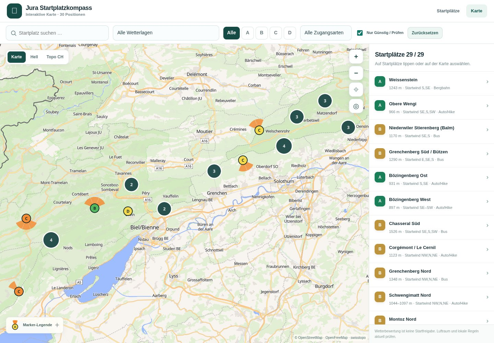

# Difficulty, priority and launch-wind markers

Feature branch: `feature/informative-map-markers`, based on published `main` at `0aa1751777db8c7463a82a0c5bc503d647e2241b`. This candidate is separate from the verified published release. Related ideas: [issue #5](https://github.com/michu173/Jura-Startplatzkompass/issues/5). The other backlog features are outside this change.

## Marker meanings

- Circle colour uses only `schwierigkeit_kanonisch`: Leicht green (`#54b85f`), Mittel yellow (`#f5d94c`), Schwer orange (`#f28b34`). Unknown values are neutral grey, never silently rated easy.
- The dark A–D letter remains the user's personal priority. Difficulty and priority are independent: an A marker can be yellow.
- Orange fans point toward the direction **the launch wind comes from**, not the direction of flight. Each stored eight-point compass direction is represented schematically by a 45° wedge; these are not measured operating limits.
- Comma-separated directions, contiguous short compass ranges (including north wraparound), and German O/SO/NO notation are supported. Disjoint directions retain gaps. Unrecognised or ambiguous expressions do not generate a fan.
- Parenthetical conditions and text after semicolons are not parsed as favourable directions. For example, the Chasseral north record remains N only; the excluded NW in its note does not become a sector.
- Tannmatt Ost's unresolved wind-sector comparison issue suppresses its fan. Les Roches d’Orvin's unverified/rejected directions also produce no fan. Niederwiler Stierenberg Nord retains its stored N sector; that does not resolve its separate operating-status uncertainty. Existing details and source evidence remain authoritative.
- Cluster circles remain neutral and display counts of launch positions; clicking expands them. Selected individual launches have a contrasting white/dark halo. The collapsible map legend explains the three independent meanings and missing fans.

## Implementation and preservation

`js/map-markers.js` contains the presentation mapping, conservative direction parser and generated RGBA wind sprites. `js/map.js` adds these sprites to the existing MapLibre style and restores them along with six application overlay layers after full style reloads. No new CDN, provider, dependency, backend, API key, persisted database or build is introduced. Fan rotation follows map bearing.

The canonical JSON, shared data module, compass logic, provider styles and attributions are unchanged. All 29 groups and 30 launch positions keep their IDs and coordinates. Both Schwengimatt positions retain the existing group-level difficulty/wind information and their distinct heights; no per-variant facts are invented.

Dataset SHA-256: `68e4e782fecb4b1e48c44b8fc8abcd95ab4868bf85275caaf1ed3de80c609c2a`.

Cache references: map entry `20261021-3`, stylesheet on both pages `20261021-2`, new marker module `20261021-1`. Unchanged compass/common module references remain `20261021-1`.

## Verification checkpoint

All 22 named Node regression tests pass (18 existing plus four marker-specific tests). New coverage includes direction ranges/exclusions, canonical difficulty independent of priority, unresolved/unknown sectors, fan pixel orientation/disjoint gaps, and sprite/layer/selection restoration. These tests use actual modules with API doubles and are separate from rendered-browser acceptance.

All **50 actual Chromium/SwiftShader browser checks passed**: 47 main acceptance checks and three initially filtered startup/reset/error checks. The runtime tested is committed as `0dd0ab553cd3c2af7257342f996b7a81dad9f300`; the subsequent evidence commit changes documentation/assets only. The main run was 21 October 2026, 20:10–20:14 UTC. The renderer was Chromium 154.0.8037.57 / ANGLE Vulkan SwiftShader WebGL 2, with the real MapLibre library and live OpenFreeMap/swisstopo resources. The browser trusted the environment proxy CA with TLS verification enabled; no renderer, network-response or DOM doubles supplied browser behavior.

Passed: all three basemaps, three full switching cycles, rapid switches, actual rendered fans/circles/priority letters, real cluster/marker clicks, selected halo, both Schwengimatt variants and heights across all styles, filters/reset, initially filtered loading and sprite expansion, zoom/pan/fit, 1440×1000 / 768×1024 / 390×844 layouts, phone modal/focus, expanded phone legend, geographic fan alignment on a rotated map, and compass-to-map filter preservation. Screenshots were inspected for desktop basemaps, phone markers and the expanded phone legend.

No uncaught JavaScript errors, MapLibre error events or application/map-resource HTTP failures occurred. The main run cancelled 23 superseded requests with `net::ERR_ABORTED`. Existing external-style null-expression/missing-POI-sprite warnings and a favicon resource-404 console diagnostic were non-blocking. A test initially checked the selection halo before the asynchronous source worker had rendered; waiting for the real rendered halo allowed the remaining checks to pass without an application change.

Detailed check names, timestamps and source hashes: [verification record](docs/marker-verification.json). These checks ran against the branch on localhost with live providers; they are **not** published-feature acceptance. Native iPhone Safari, hardware performance and Windows Edge remain unverified. The existing published release remains unchanged.

The implementation and software-browser checks are complete for review. Await user authorization before merging this runtime feature. After an authorized merge, verify CI, Pages and published files again. A scheduled continuation should inspect the current PR/checkpoint, fix a meaningful outstanding failure if permitted by the user's quota constraint, and otherwise avoid repeating completed work or expanding the backlog.
