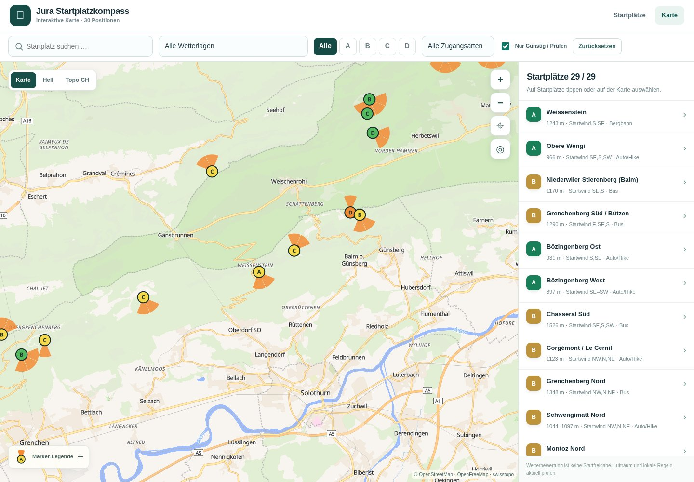

# Difficulty, priority and launch-wind markers

Feature branch: `feature/informative-map-markers`, based on published `main` at `0aa1751777db8c7463a82a0c5bc503d647e2241b`. This candidate is separate from the verified published release. Related ideas: [issue #5](https://github.com/michu173/Jura-Startplatzkompass/issues/5). The other backlog features are outside this change.

## Marker meanings

- Circle colour uses only `schwierigkeit_kanonisch`: Leicht green (`#54b85f`), Mittel yellow (`#f5d94c`), Schwer orange (`#f28b34`). Unknown values are neutral grey, never silently rated easy.
- The dark A–D letter remains the user's personal priority. Difficulty and priority are independent: an A marker can be yellow.
- Orange fans point toward the direction **the launch wind comes from**, not the direction of flight. Each stored eight-point compass direction is represented schematically by a 45° wedge; these are not measured operating limits.
- Comma-separated directions, contiguous short compass ranges (including north wraparound), and German O/SO/NO notation are supported. Disjoint directions retain gaps. Unrecognised or ambiguous expressions do not generate a fan.
- Parenthetical conditions and text after semicolons are not parsed as favourable directions. For example, the Chasseral north record remains N only; the excluded NW in its note does not become a sector.
- Tannmatt Ost's unresolved wind-sector comparison issue suppresses its fan. Les Roches d’Orvin's unverified/rejected directions also produce no fan. Niederwiler Stierenberg Nord retains its stored N sector; that does not resolve its separate operating-status uncertainty. Existing details and source evidence remain authoritative.
- Every launch matching the current filters remains an individual circle at every zoom; clustering and cluster-click zoom are removed. Priority letters allow overlap rather than being hidden by collision placement. Markers remain at their stored coordinates, so close neighbours can overlap when zoomed far out.
- Orange fans are hidden below zoom 11.5 and appear at zoom 11.5 and above. Circle/letter sizes are smaller in the overview. Selected launches keep the contrasting white/dark halo. The legend distinguishes overview hiding from an unknown direction at detail zoom.

## Implementation and preservation

`js/map-markers.js` contains the presentation mapping, conservative direction parser and generated RGBA wind sprites. `js/map.js` adds these sprites to the existing MapLibre style and restores them along with four application overlay layers after full style reloads. No new CDN, provider, dependency, backend, API key, persisted database or build is introduced. Fan rotation follows map bearing.

The canonical JSON, shared data module, compass logic, provider styles and attributions are unchanged. All 29 groups and 30 launch positions keep their IDs and coordinates. Both Schwengimatt positions retain the existing group-level difficulty/wind information and their distinct heights; no per-variant facts are invented.

Dataset SHA-256: `68e4e782fecb4b1e48c44b8fc8abcd95ab4868bf85275caaf1ed3de80c609c2a`.

Cache references: map entry `20261021-4`, stylesheet on both pages `20261021-2`, new marker module `20261021-1`. Unchanged compass/common module references remain `20261021-1`.

## Current verification — ungrouped markers and detail-only fans

All **22 named Node regression tests passed** after this refinement. The obsolete cluster-expansion test is replaced by individual-marker selection without camera zoom; source clustering is explicitly disabled and fan minimum zoom is checked. Existing data/filter/error/selection/variant and sprite-restoration coverage remains.

All **25 focused real-browser checks passed** for runtime commit `451a9b4756e576688467a244b2cf8e22581cc535`. Chromium 154.0.8037.57 used actual SwiftShader WebGL 2, the real MapLibre library and live OpenFreeMap/swisstopo resources. The browser used the configured proxy CA with TLS verification enabled. No map, network-response or DOM doubles supplied browser behaviour. Run: `2026-10-21T20:25:17.160Z` to `2026-10-21T20:30:08.254Z` (UTC).

Checked all 30 rendered circle IDs in the initial view and at zoom 8 on each basemap, absence of grouping, fan invisibility at zoom 11.49, visibility at zoom 11.5, hiding again after zoom-out, real marker clicks/halo without cluster zoom, priority filters/reset, rapid style changes, both Schwengimatt positions/selection, tablet/phone overviews, detail fans and the revised phone legend. Distant overlapping identical priority letters can be coalesced by MapLibre's symbol renderer; all 30 circles remain independently rendered. No positions are offset to separate neighbours.

No uncaught JavaScript errors, MapLibre error events or application/map-resource HTTP errors occurred. Superseded camera/style requests may be cancelled with `net::ERR_ABORTED`.

Current named checks and source hashes: [verification record](docs/marker-verification.json). The earlier clustered candidate's 50 passing checks at `0dd0ab5` are retained as [historical evidence](docs/marker-verification-initial.json); they are not the acceptance claim for this refinement.

Overview — individual circles, fans hidden:

Detail zoom — direction fans visible:

The implementation is ready for PR review. Tests use localhost feature files with live providers, not the published feature. Native iPhone Safari, hardware performance and Windows Edge remain unverified. The existing published release remains unchanged. Await user authorization before merging; after an authorized merge, verify CI, Pages and published files again. A scheduled continuation should inspect the current PR/checkpoint and avoid repeating completed work or expanding the backlog.
