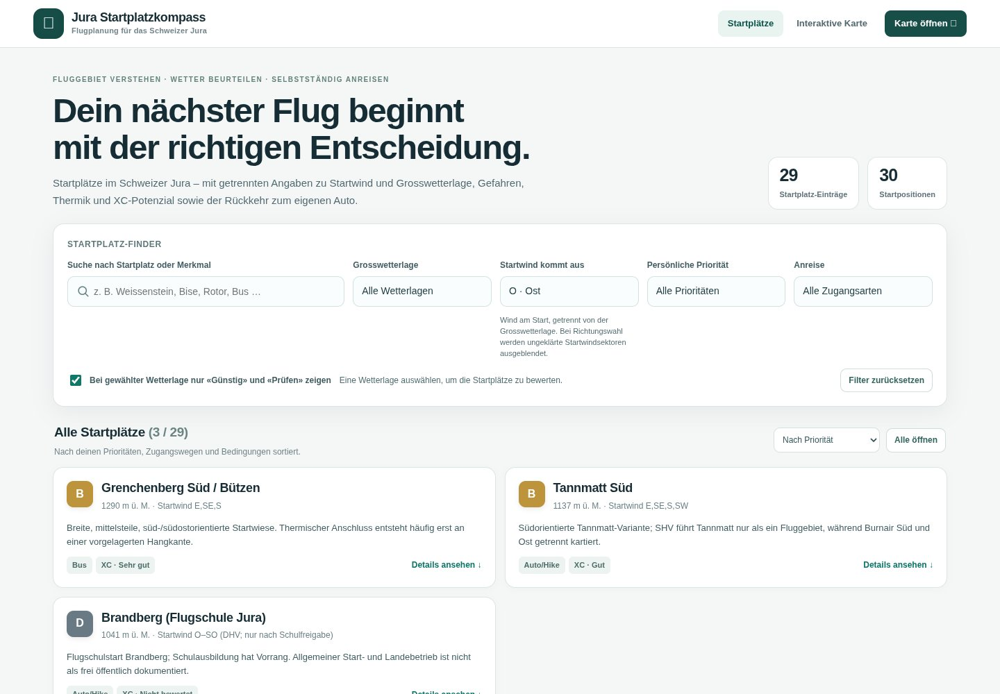
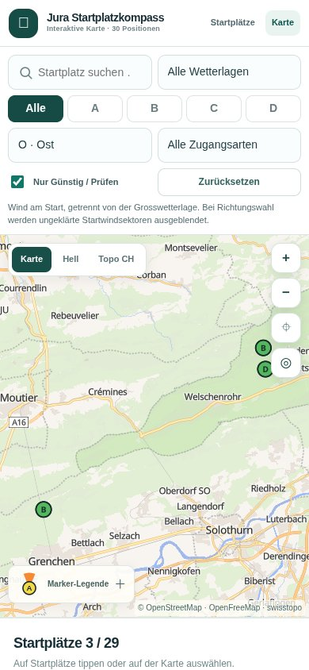

# Independent launch-wind filter — feature 1

Implemented on `feature/launch-wind-filter` in [PR #7](https://github.com/michu173/Jura-Startplatzkompass/pull/7), stacked on the unmerged marker PR #6. The published release is unchanged.

## Behaviour

Both compass and map have a labelled **Startwind kommt aus** control, separate from **Grosswetterlage**. Values are the eight compass directions; the German UI uses NO/O/SO while the canonical URL values remain NE/E/SE. The shared `wind` query parameter survives reload and navigation with other filters/search/sort. Invalid values normalize to no direction filter. Reset clears wind together with the existing defaults.

Filtering intersects the stored launch-wind sectors with weather, priority, access and search. With no wind selection, all 29 groups/30 positions remain available under the other filters. North alone matches ten groups/eleven positions, including both Schwengimatt variants; east matches three groups; west produces the existing useful empty state. Only the currently filtered points are displayed; they stay individual at every zoom and fans retain their zoom-11.5 threshold.

The shared `js/launch-wind.js` interpretation is reused by filtering and marker fans. It reads the leading canonical direction list/range, handles German notation and does not turn parenthetical exclusions into positive matches. Tannmatt Ost's unresolved sector and Orvin's unverified/rejected directions are excluded when a direction is selected. An unresolved operating-status issue does not silently erase an independently stored wind direction or imply operating permission. Existing descriptions/conditions and source uncertainty remain intact.

## Preservation and cache references

The dataset, coordinates, IDs, relationships, all original source facts and map providers are unchanged. JSON SHA-256 remains `68e4e782fecb4b1e48c44b8fc8abcd95ab4868bf85275caaf1ed3de80c609c2a`. No backend, accounts, live weather service, new map provider or runtime installation is added.

Changed CSS, compass/map entry modules and both common-module imports use `20261022-1`; marker module stays `20261021-2`, shared launch-wind module `20261021-1`. Both pages reference the new stylesheet version.

## Verification

All **27 named Node regressions passed**, including 2,880 combined wind/weather/priority/access/suitability cases, exact direction memberships/exclusions, search composition, URL validation, navigation under throttled history, map controls/reset and existing lifecycle/data/variant/error tests.

All **32 real Chromium/SwiftShader browser checks passed** for runtime `1d042c93e46a565f649b9d3ce1afcd9ba15f1d88`. They cover all eight directions on both pages, invalid URL recovery, independent weather/launch-wind filtering, reset, compass/map navigation with search and variants, all three basemaps, no clustering, the fan zoom threshold, lower Schwengimatt selection/height, accessible labels/descriptions, visible controls/checkbox/canvas and no horizontal overflow at 1440×1000, 768×1024 and 390×844.

The checks loaded real feature files over localhost with actual MapLibre, OpenFreeMap and swisstopo resources, without renderer/DOM/network-response doubles. Chromium 154.0.8037.57 used ANGLE/Vulkan SwiftShader WebGL 2. The environment proxy CA was trusted with TLS verification enabled. No uncaught JavaScript errors, MapLibre error events or application/map-resource HTTP failures occurred. Superseded requests can be cancelled with `net::ERR_ABORTED`; a missing favicon is non-blocking.

[Named browser checks, times and source hashes](docs/wind-filter-verification.json). This is feature-branch acceptance, not published-feature, native iPhone Safari, hardware performance or Windows Edge acceptance.

## Release and next task

Keep PR #7 separate and stacked on #6 until the parent is handled. Do not merge or deploy either runtime feature without subsequent user authorization. After an authorized merge, verify current CI, Pages and published-file parity.

Task 1 implementation is complete. Task 2 (independent return-to-car planning) remains queued in FEATURE_ROADMAP.md, pending a fresh weekly-quota report as required by the bounded unattended-work instruction.
